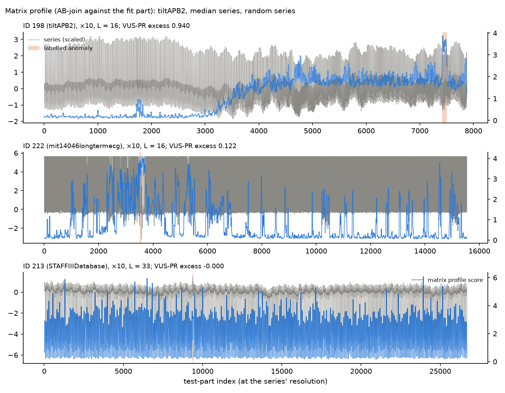
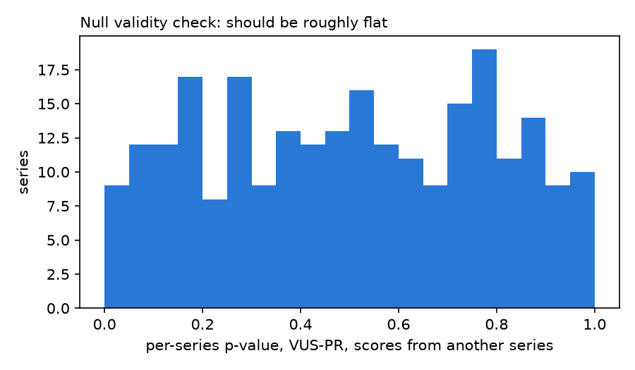

# MOMENT zero-shot anomaly detection, evaluated against chance

Younes Ziri, research project for *Apprentissage pour les séries temporelles* (MVA, L. Oudre), on
[MOMENT: A Family of Open Time-series Foundation Models](https://arxiv.org/abs/2402.03885) (Goswami et
al., ICML 2024).

**Question.** Question: “The paper reports that zero-shot MOMENT beats k-NN and four deep-learning detectors (TimesNet, Anomaly Transformer, DGHL, GPT4TS) on point-adjusted F1, which can reward random scores. I re-test it against k-NN and simple course baselines: how much of that advantage survives when each detector is measured against its own chance level?”

**Answer (preliminary).** MOMENT beats its own chance level but is not shown to beat k-NN, and a
simple matrix-profile baseline reaches about ten times its score on the range-aware metric (VUS-PR).

**Status: work in progress.** **The 248-series numbers below are
preliminary: first full run, 23/10/2026; final run pending.** In this first run a bug removed MOMENT
from 9 series (fixed for the final run, `docs/analysis_plan.md`, D10). Every 248-series number comes from
`results/248/summary.md` (produced by `scripts/analyse_248.py`).

## Summary

1. **The paper's numbers reproduce.** With the authors' data and rules and the released MOMENT-1-large
   weights, adjusted best F1 is 0.586 and VUS-ROC 0.671 (Table 7: 0.585 and 0.670); k-NN gets 0.552 and
   0.712 (Table 7: 0.554 and 0.706), over the 238 series the authors' pipeline keeps.
2. **MOMENT beats chance, but not k-NN.** On VUS-PR, MOMENT exceeds its own circularly shifted scores by
   0.019 (clustered 95% CI [0.012, 0.027], p < 0.001), the pre-registered confirmatory result. Against
   k-NN the estimate favours k-NN (−0.074), not significant under the pre-registered rule (two-sided
   p = 0.096), so the test sequence stops there.
3. **A course baseline does far better (descriptive).** The matrix profile (AB-join against the
   anomaly-free fit part) reaches a VUS-PR of 0.333, about 10× MOMENT's 0.034.
4. **The paper's metric gives each detector a different chance level, which reverses rankings.** On
   adjusted best F1, chance is 0.37 for MOMENT, 0.28 for k-NN and 0.10 for the matrix profile. MOMENT
   leads on the raw metric (0.611 vs 0.575 for k-NN and 0.409 for the matrix profile) but trails on the
   excess over chance (0.244 vs 0.298 and 0.311).

The question, the protocol and every decision were fixed before the first run in
[`docs/analysis_plan.md`](docs/analysis_plan.md) (later changes logged there as dated deviations).

## Reproduction (the authors' data and rules)

"Paper-faithful": the authors' TSB-UAD files, the rules of their research code
(`moment-research`, commit 3ab637e), and the released weights.

| Detector | Adjusted best F1 (ours) | Table 7 | VUS-ROC (ours) | Table 7 |
|---|---|---|---|---|
| MOMENT-1-large | 0.586 | 0.585 | 0.671 | 0.670 |
| k-NN | 0.552 | 0.554 | 0.712 | 0.706 |

The authors' pipeline leaves 10 of the 248 series with nothing to score (see below) and drops them from
its means. Our mean over the 238 series the pipeline keeps matches Table 7; counting the 10 others as 0
gives 0.562 for MOMENT's adjusted best F1. This is consistent with Table 7 averaging those 238 series,
but we cannot verify it. On tiltAPB2 (ID 198), MOMENT gets 0.960 and 0.747 (Table 22: 0.96 and 0.75).

## Detectors and metrics

- **MOMENT-1-large**, zero-shot: reconstruction error of each 512-point window, nothing masked.
  **Masked**: each patch is hidden in one of 4 passes and predicted from the others.
- **k-NN** as in the authors' code: mean of the 5 nearest anomaly-free training windows.
- **Course baselines** (Lecture 5): **Mu-Sigma** and **Med-Mad**, distance to the mean (median) of the
  last L points in standard deviations (median absolute deviations); the **matrix profile**, distance
  from each test subsequence of length L to its nearest neighbour in the anomaly-free fit part
  (AB-join), or anywhere else in the series (self-join, exploratory).
- **L**: the dominant period of the train part (first autocorrelation peak), clipped to [16, 512].
- **VUS-PR**: volume under the range-based precision-recall surface (Paparrizos et al. 2022), with
  window L; threshold-free, gives credit near the anomaly.
- **Top-1**: the single highest score lies within ±100 original points of the anomaly (the archive's
  own scoring).

## Main results

"Consistent": the original UCR archive, one downsampling factor per series (chosen from the test
part's length, the paper's ×10 rule, then applied to every part), L computed on the train part, the
235 series where every detector ran. Chance = each detector's own test scores circularly shifted
(100 shifts); for top-1 the exact chance |Z|/n.

| Detector | VUS-PR | chance | excess | top-1 | chance | adj. best F1 | chance |
|---|---|---|---|---|---|---|---|
| MOMENT-1-large | 0.034 | 0.014 | 0.020 | 0.209 | 0.024 | 0.611 | 0.367 |
| MOMENT-1-large, masked | 0.038 | 0.015 | 0.023 | 0.128 | 0.024 | 0.574 | 0.351 |
| k-NN | 0.111 | 0.017 | 0.093 | 0.328 | 0.024 | 0.575 | 0.277 |
| Mu-Sigma | 0.024 | 0.014 | 0.010 | 0.191 | 0.024 | 0.435 | 0.356 |
| Med-Mad | 0.025 | 0.016 | 0.009 | 0.085 | 0.024 | 0.336 | 0.286 |
| Matrix profile (AB-join) | 0.333 | 0.029 | 0.304 | 0.370 | 0.024 | 0.409 | 0.098 |
| Matrix profile, self-join (exploratory) | 0.386 | 0.029 | 0.357 | 0.421 | 0.024 | 0.453 | 0.099 |

Confirmatory tests, on every series each detector ran on (fixed sequences at α = 0.05; significant =
clustered bootstrap 95% interval excludes 0 and two-sided p < 0.05):

| Test | n | Estimate | 95% CI (clustered) | p | Outcome |
|---|---|---|---|---|---|
| 1. VUS-PR, MOMENT vs chance | 239 | +0.019 | [0.012, 0.027] | < 0.001 | significant |
| 2. VUS-PR, MOMENT vs k-NN | 235 | −0.074 | [−0.142, −0.014] | 0.096 | not significant; sequence stops |
| 3. top-1, MOMENT vs chance | 239 | 49 hits, 5.8 expected | [0.085, 0.296] | < 0.001 | reported, not confirmatory |
| 4. top-1, MOMENT vs k-NN | 235 | 49 vs 77 hits | [−0.256, −0.004] | < 0.001 | reported, not confirmatory |
| Q3. VUS-PR, masked vs unmasked | 239 | +0.004 | [−0.012, 0.032] | 0.011 | not significant; sequence stops |

The null holds up: scores borrowed from another series reach p ≤ 0.05 in 3.6% of series (5% expected).

## What we found in the released code and data

Observations about `moment-research` at commit 3ab637e unless stated otherwise.

- **10 series with nothing to score.** Four labelling problems in the authors' TSB-UAD files: IDs 79,
  108 and 187 have no labelled point, and ID 203 keeps a pre-correction training end that puts its
  anomaly in the training part (`results/label_check.md`). Six anomalies (IDs 72, 85, 180, 193, 229,
  232) lie entirely in the test tail that is never scored: windows are counted as
  `(len − 512) // 512 + 1` (`moment/data/anomaly_detection_datasets.py`, l. 374–375). IDs 61, 105 and
  169 lose part of theirs (44 of 60 ×10 blocks scored). For such series VUS raises an error that a bare `except:`
  turns into NaN (`moment/utils/anomaly_detection_metrics.py`, l. 67 and 74), and the results loop drops
  NaN rows (`scripts/zero_shot/anomaly_detection.py`, l. 175).
- **Each part downsampled according to its own length** (`anomaly_detection_datasets.py`, l. 245 and
  278–290). In 81 series, k-NN is therefore trained and scored at different resolutions.
- **The text says 2560, the code 25,600.** The paper downsamples series "longer than 2560 timesteps"
  (App. E.3); the code does so when `length // 10 > 2560` (l. 245; `configs/anomaly_detection/zero_shot.yaml`,
  l. 29–30).
- **The tutorial runs with dropout on** (`moment` repository, `tutorials/anomaly_detection.ipynb`): it
  never calls `model.eval()`, and with momentfm 0.1.4's pinned huggingface-hub the weights load in
  training mode, so scores change on every call.
- **The Small and Base reconstruction heads are untrained.** Read from the released checkpoints: zero
  bias and orthogonal weight rows with gain 1.41 (W·Wᵀ = 1.41²·I to 4 decimals), i.e. momentfm's
  initialisation; neither reconstructs a sine wave, even with masked scoring. Only Large does
  (`results/moment_diagnostics.md`).

## Figures



Matrix profile (AB-join) on tiltAPB2, the median series and a random one (chosen by a fixed rule,
`scripts/plot_matrix_profile.py`).



Per-series p-values when MOMENT's scores come from another series: roughly flat, as they should be.

## Limitations

- MOMENT's pretraining data includes this archive (paper, Table 12), which would favour MOMENT.
- One benchmark (UCR): one anomaly per series, many of them synthetic.
- The window L of VUS-PR and of the course baselines comes from a fixed rule (the first
  autocorrelation peak), not tuned.
- VUS is computed with the authors' copy of the VUS code, which may differ slightly from the current
  VUS release.
- One model configuration: MOMENT-1-large, positional embedding on.
- The matrix-profile comparison is descriptive, not a pre-registered test.
- One run so far.

## References

- Goswami et al. (2024). MOMENT: A Family of Open Time-series Foundation Models. ICML.
  [arXiv:2402.03885](https://arxiv.org/abs/2402.03885); code:
  [moment](https://github.com/moment-timeseries-foundation-model/moment) (package and tutorials),
  [moment-research](https://github.com/moment-timeseries-foundation-model/moment-research) (paper code).
- Paparrizos et al. (2022). TSB-UAD: An End-to-End Benchmark Suite for Univariate Time-Series Anomaly
  Detection. PVLDB. [Code and data](https://github.com/TheDatumOrg/TSB-UAD).
- Wu & Keogh (2021). Current Time Series Anomaly Detection Benchmarks are Flawed and are Creating the
  Illusion of Progress. IEEE TKDE. [UCR Anomaly Archive](https://www.cs.ucr.edu/~eamonn/time_series_data_2018/).
- Paparrizos et al. (2022). Volume Under the Surface: A New Accuracy Evaluation Measure for
  Time-Series Anomaly Detection. PVLDB. [Code](https://github.com/TheDatumOrg/VUS).
- Liu & Paparrizos (2024). The Elephant in the Room: Towards A Reliable Time-Series Anomaly Detection
  Benchmark. NeurIPS Datasets and Benchmarks. [Code](https://github.com/TheDatumOrg/TSB-AD).
- Yeh et al. (2016). Matrix Profile I: All Pairs Similarity Joins for Time Series. ICDM.
  [Matrix Profile page](https://www.cs.ucr.edu/~eamonn/MatrixProfile.html).
- Kim et al. (2022). Towards a Rigorous Evaluation of Time-Series Anomaly Detection. AAAI.
- L. Oudre, *Machine Learning for Time Series*, Lecture 5: Change-point and Anomaly Detection, MVA.


## Reproduce

```bash
uv sync                                       # Python 3.11, pinned dependencies
uv run python scripts/download_data.py        # TSB-UAD (241 MB) and the UCR archive (184 MB)
uv run python scripts/check_labels.py
caffeinate -i sh -c 'for k in 0 1 2; do uv run python scripts/run_248.py --part $k/3 & done; wait;
                     uv run python scripts/run_248.py'      # about 4.5 h on a MacBook Air M2
uv run python scripts/analyse_248.py
uv run python scripts/plot_matrix_profile.py
```

The single-series case study (tiltAPB2) is in `results/tiltAPB2_x1.md` and `results/tiltAPB2_x10.md`
(`scripts/run_case_study.py`).
