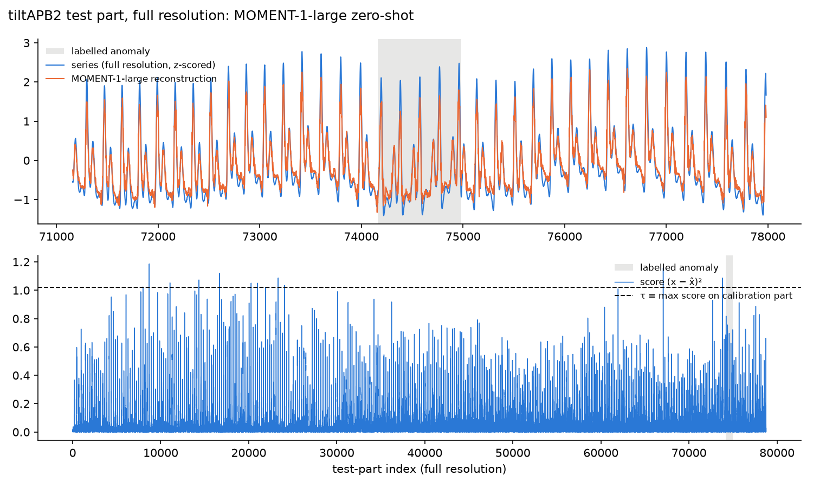

# MOMENT zero-shot anomaly detection, evaluated against chance

Mini-project for *Apprentissage pour les séries temporelles* (MVA, L. Oudre): zero-shot anomaly
detection with MOMENT (Goswami et al., ICML 2024), re-evaluated with metrics calibrated against
chance. **Work in progress**: so far, one series; the 248-series study is next.

## Summary (one series: tiltAPB2, the series of the authors' own tutorial)

1. **The paper's number reproduces, but on this series the paper's metric is weak evidence of
   detection.** Under the paper's ×10 protocol, MOMENT-1-large gets an adjusted best F1 of 0.960
   (paper: 0.96, Table 22). Our reference chance level is MOMENT's own scores slid in time (same
   values, same clustering, alignment with the anomaly broken): they reach at least 0.960 in about 5%
   of shifts (p = 0.055). At full resolution (the tutorial's protocol) MOMENT gets 0.922 and its
   shifted scores average 0.834 (p = 0.38). The metric depends on the *shape* of the score
   distribution, not only on the ranking: at full resolution, random uniform scores average 0.679 on
   it and random squared-Gaussian scores 0.945.
2. **Under stricter metrics, MOMENT's signal depends on the resolution, and it doesn't give a useful
   alert.** At full resolution its point-wise best F1 (0.050) and AUC-PR (0.014) are above its own
   shifted scores (p = 0.002 and 0.005); under the ×10 protocol only borderline (AUC-PR 0.027,
   p = 0.05). Its highest score is not near the anomaly, and a threshold set without labels raises 12
   false alarms but never fires on the anomaly. k-NN has a higher AUC-PR at full resolution (0.022),
   but it is not clearly above its own shifted scores (p = 0.063), and it catches the anomaly (with 276
   false alarms) in 59% of its own shifts too. One series cannot rank detectors.
3. **The released setup has pitfalls.** With momentfm's pinned dependencies the model loads with
   dropout on, and the tutorial doesn't switch it off; the published small and base checkpoints
   contain a reconstruction head that matches momentfm's initialisation exactly, so only large works
   zero-shot; and the released weights need the positional embedding that the authors' zero-shot
   config turns off.

One series is a case study, not a conclusion about MOMENT: see [Limitations](#limitations).



## Question

Does MOMENT's zero-shot anomaly-detection advantage on the UCR archive hold under an evaluation
calibrated against chance: compared with random scores, with no credit for a whole anomaly from
one lucky point, and with a threshold chosen without the labels?

## What we did

- **Data and model, as the authors' tutorial** ([moment](https://github.com/moment-timeseries-foundation-model/moment),
  `tutorials/anomaly_detection.ipynb`): series tiltAPB2 from the UCR Anomaly Archive (arterial blood
  pressure on a tilt table; the anomaly, 826 points, is synthetic), MOMENT-1-large with the released
  weights, windows of 512, score = squared reconstruction error. Two fixes: `model.eval()`
  (the tutorial leaves dropout on) and reading the first data point (the tutorial drops it).
- **Two protocols**: full resolution, as the tutorial; and ×10 max-pooling, as the paper's research
  code ([moment-research](https://github.com/moment-timeseries-foundation-model/moment-research)) for Table 22.
- **Splits**: train part [0, 50000) cut into fit [0, 42857) and calibration [42857, 50000) with the
  paper's 6/7 ratio; test [50000, end). k-NN is trained on the fit part, so unlike MOMENT it is not
  zero-shot. The calibration part only sets the alert threshold τ (its maximum score); no labels are used.
- **Baselines**: k-NN as in the authors' code (5 neighbours, 512-point windows). Chance: each
  detector's own test scores circularly shifted in time (1000 offsets drawn without replacement from
  all non-zero offsets, the standard rotation test), the reference; and random scores, uniform and squared Gaussian
  (1000 draws each), to show how the paper's metric depends on the shape of the scores.
- **Metrics**: the paper's adjusted best F1 (our implementation is tested equal to momentfm's), the
  same on rank scores, point-wise best F1, AUC-PR, AUC-ROC, UCR top-1 (highest score within
  ±100 points of the anomaly), and alerting at τ (detected, false-alarm events, delay). Empirical
  p-value against each chance baseline: (1 + #draws scoring at least as well) / 1001.

## Results

Full resolution (the tutorial's protocol), from [`results/tiltAPB2_x1.md`](results/tiltAPB2_x1.md),
produced by `scripts/run_case_study.py`:

| Method | Adj. best F1 (paper) | Same, rank scores | Best F1, point-wise | AUC-PR | AUC-ROC | UCR top-1 |
|---|---|---|---|---|---|---|
| MOMENT-1-large | 0.922 | 0.684 | 0.050 | 0.014 | 0.524 | no |
| k-NN (fit part) | 0.738 | 0.676 | 0.057 | 0.022 | 0.711 | no |
| Random uniform (1000 draws) | 0.679 ± 0.025 | 0.679 ± 0.023 | 0.022 ± 0.001 | 0.011 ± 0.000 | 0.500 ± 0.010 | 9/1000 |
| Random squared Gaussian (1000 draws) | 0.945 ± 0.047 | 0.680 ± 0.032 | 0.022 ± 0.001 | 0.011 ± 0.000 | 0.500 ± 0.010 | 13/1000 |
| MOMENT-1-large, circular shift (1000 shifts) | 0.834 ± 0.138 | 0.651 ± 0.075 | 0.025 ± 0.004 | 0.011 ± 0.001 | 0.499 ± 0.036 | 11/1000 |
| k-NN, circular shift (1000 shifts) | 0.486 ± 0.403 | 0.392 ± 0.295 | 0.033 ± 0.012 | 0.013 ± 0.006 | 0.499 ± 0.212 | 11/1000 |

Empirical p-values, against random uniform / random squared Gaussian / **the method's own scores,
circularly shifted** (the reference). 0.001 is the smallest value 1000 draws allow (1/1001), so read
it as p ≤ 0.001:

| Method | Adj. best F1 (paper) | Same, rank scores | Best F1, point-wise | AUC-PR | AUC-ROC |
|---|---|---|---|---|---|
| MOMENT-1-large | 0.006 / 0.741 / **0.379** | 0.006 / 0.011 / **0.011** | 0.001 / 0.001 / **0.002** | 0.001 / 0.001 / **0.005** | 0.005 / 0.005 / **0.234** |
| k-NN (fit part) | 0.006 / 1.000 / **0.437** | 0.828 / 0.856 / **0.436** | 0.001 / 0.001 / **0.027** | 0.001 / 0.001 / **0.063** | 0.001 / 0.001 / **0.079** |

Alerting at τ = max score on the calibration part (no labels): MOMENT does not detect the anomaly
and raises 12 false-alarm events; its shifted scores detect it in 133 of 1000 shifts, with about 12
false-alarm events each. k-NN detects it 25 points after its start, with 276 false-alarm events; its
shifted scores detect it in 585 of 1000 shifts, with about 282 false-alarm events each.

×10 max-pooled (the paper's protocol), from [`results/tiltAPB2_x10.md`](results/tiltAPB2_x10.md):
MOMENT-1-large's adjusted best F1 is 0.960 (paper: 0.96); its shifted scores average 0.519 ± 0.222
and reach 0.960 in about 5% of shifts (p = 0.055). Against its own shifted scores, its p-values are
0.067 on rank scores, 0.087 for point-wise best F1, 0.050 for AUC-PR (0.027) and 0.016 for AUC-ROC.
k-NN's AUC-PR is 0.019 (p = 0.131): below MOMENT at ×10, above it at full resolution (0.022 vs
0.014).

### How to read these numbers

- **Why random scores do so well on the paper's metric.** Point-adjust counts the whole anomaly
  as detected as soon as one alert falls inside it, and the best of 100 thresholds is picked with
  the labels. The thresholds are spaced evenly between the minimum and maximum score, so their
  position depends on the shape of the score distribution. A back-of-the-envelope check (not a
  script output): for uniform scores, the second-highest threshold flags about 1% of the 78,767 test
  points; a few land in the anomaly, so recall is 1 and precision is about 826 / (826 + 790) ≈ 0.51,
  which gives F1 ≈ 0.68, close to the measured 0.679. Squared-Gaussian scores
  have a long tail, so several thresholds flag only a few dozen points; when one of them falls in
  the anomaly, F1 is about 0.95.
- **Shape, not scale.** Multiplying or shifting the scores moves all 100 thresholds with them and
  changes nothing; only a non-linear reshaping (squaring, ranking) changes the result. That is why
  two random baselines are shown, and why the reference chance level for each detector uses its own
  scores.
- **Why a circular shift.** iid random scores (or a shuffle) scatter the high scores, while a
  detector's high scores come in clusters (here, on heartbeat peaks). Scattered high scores give many
  independent chances to land in the anomaly, which is harsh on the detector under point-adjusted F1;
  they also make AUC-type metrics vary less than clustered scores do, which flatters the detector.
  Sliding the detector's own score series in time keeps the values and the clustering and only breaks
  the alignment with the anomaly. The difference is large: MOMENT's ×10 AUC-PR has p = 0.003
  against squared-Gaussian noise but p = 0.050 against its own shifted scores.
- **Rank scores** replace each score by its rank: the ordering, and so every possible alert, is
  unchanged, but the shape is gone. Uniform and squared-Gaussian scores then agree (0.679, 0.680),
  and MOMENT is barely above them (0.684).
- **AUC-PR before AUC-ROC.** With about 1% anomalous points, AUC-ROC is optimistic: many false
  alarms barely move the false-positive rate (course, Lecture 5, p. 90). k-NN shows it: AUC-ROC
  0.711, AUC-PR 0.022.
- **Best-score metrics are upper bounds.** Adjusted best F1 and point-wise best F1 choose the
  threshold on the test labels (course, p. 91). Alerting at τ is the only metric here with a threshold
  set without labels.

### Released checkpoints

From [`results/moment_diagnostics.md`](results/moment_diagnostics.md), produced by
`scripts/diagnose_moment.py`:

| Model | max abs(head bias) | max abs(W·Wᵀ − 1.41²·I) | corr(sine, reconstruction), embedding on / off |
|---|---|---|---|
| MOMENT-1-small | 0.0000 | 0.0000 | −0.066 / 0.111 |
| MOMENT-1-base | 0.0000 | 0.0000 | 0.001 / −0.162 |
| MOMENT-1-large | 0.0121 | 1.3097 | 0.987 / −0.562 |
| small, no weights loaded | 0.0000 | 0.0000 | 0.028 / – |

- **The head values are read directly from the `.safetensors` files** (Hugging Face revisions
  `411e288267`, `5e44b0ea26`, `ca58581bc7` for small, base, large). For small and base they match
  momentfm's initialisation exactly (zero bias, orthogonal rows scaled by 1.41, so W·Wᵀ = 1.41²·I),
  like a model with no weights loaded; training would have moved them, so we infer these heads were
  never trained. Neither model reconstructs even a sine wave. This also rules out the idea that they
  were trained only to predict masked patches: a head trained on anything would have moved.
- **The positional embedding:** all three checkpoints load with `strict=True` with it on, and contain
  its table (`patch_embedding.position_embedding.pe`), so they were saved with it; with it off,
  `strict=True` loading fails on that table, and Large no longer reconstructs.

## Limitations

- **One series**, with a synthetic anomaly. Nothing here is a claim about the 248-series average
  of the paper (Table 7).
- **Possible pretraining overlap.** The UCR series come from the KDD21 collection, which is part of
  MOMENT's pretraining data (paper, Table 12). The paper says long series were split into
  train/validation/test parts for pretraining, and the authors' tutorial says MOMENT was not exposed
  to the test part of this series; the anomaly-free part may have been seen. Not verified; it matters
  for what "zero-shot" means here.
- **Approximate p-values.** The circular shift treats every offset of the score series as equally
  plausible, and all 1000 shifts come from one series; the p-values are indicative, not exact.
- **Released weights, not the paper's checkpoint.** The paper's zero-shot code loads an internal
  pretraining checkpoint (`charmed-bee-241`) with the positional embedding off; we use the public
  weights.
- **No range-based metrics yet** (range-based precision/recall, Tatbul et al. 2018; VUS-ROC, the
  paper's second metric).
- k-NN uses the paper's zero-shot split (6/7 of the train part); its own config uses 5/7.

## Reproduce

```bash
uv sync                                                  # Python 3.11, pinned dependencies
uv run pytest                                            # 58 tests (MOMENT tests need the weights)
uv run python scripts/run_case_study.py                  # full resolution, ~11 min on an M2
uv run python scripts/run_case_study.py --factor 10      # paper protocol, ~1 min
uv run python scripts/diagnose_moment.py                 # released checkpoints, ~2 min
```

## Setup

```bash
uv run python scripts/check_setup.py      # feasibility check (downloads ~2 GB of weights)
```

- **Python 3.11 only.** `momentfm` 0.1.4 (latest on PyPI) pins `numpy==1.25.2`, which has
  no wheels for Python 3.12+, and `transformers==4.33.3`. The repo's 0.1.5 has the same model code.
- **Always call `model.eval()` after `from_pretrained`.** huggingface-hub 0.24 (pinned by
  momentfm 0.1.4) skips it when loading safetensors weights, so dropout stays on and the
  reconstruction, and therefore the anomaly score, changes on every call. The official
  tutorial doesn't call it; the authors' research code does.
- **Keep the positional embedding on and use MOMENT-1-large** for zero-shot reconstruction
  (see [Released checkpoints](#released-checkpoints)).
- **Don't upgrade torch casually.** transformers 4.33.3 calls a torch internal
  (`_register_pytree_node`) that recent torch only keeps as deprecated; the lockfile pins a
  combination that works.

### Data

`data/198_UCR_Anomaly_tiltAPB2_50000_124159_124985.out`: one series from the UCR Anomaly
Archive (Wu & Keogh), copied from the official MOMENT repo. Column 0 is the value, column 1
the label. The file has no header (read it with `header=None`). Points `[0, 50000)` are the
anomaly-free training part; the anomaly is at 0-based indices `[124159, 124984]`.

## Roadmap

1. **248 series** (UCR IDs 1–250 except 32 and 140, as the paper): reproduce Table 7 with the
   released weights, then compare MOMENT with k-NN and with chance using paired statistics across
   series (bootstrap confidence intervals, Wilcoxon test).
2. Range-based metrics (Tatbul et al. 2018) and VUS-ROC.
3. A stronger chance baseline that keeps the detector's own score distribution and burstiness
   (random circular shifts of its scores).
4. Masked scoring at inference: hide each patch in turn, as in pretraining.

## References

- Goswami et al. (2024). MOMENT: A Family of Open Time-series Foundation Models. ICML.
- Kim, Choi, Choi, Lee & Yoon (2022). Towards a Rigorous Evaluation of Time-Series Anomaly
  Detection. AAAI, 7194–7201. (Point-adjust lets random scores look good.)
- Huet, Navarro & Rossi (2022). Local Evaluation of Time Series Anomaly Detection Algorithms.
  KDD, 635–645. (Evaluation by comparison to a random detector; our p-values follow that idea,
  not their method.)
- Tatbul, Lee, Zdonik, Alam & Gottschlich (2018). Precision and Recall for Time Series. NeurIPS.
- Wu & Keogh (2021). Current Time Series Anomaly Detection Benchmarks are Flawed and are Creating
  the Illusion of Progress. IEEE Transactions on Knowledge and Data Engineering. (Introduces the
  UCR Anomaly Archive.)
- L. Oudre, *Machine Learning for Time Series*, Lecture 5: Change-point and Anomaly Detection,
  MVA 2026–2027.

